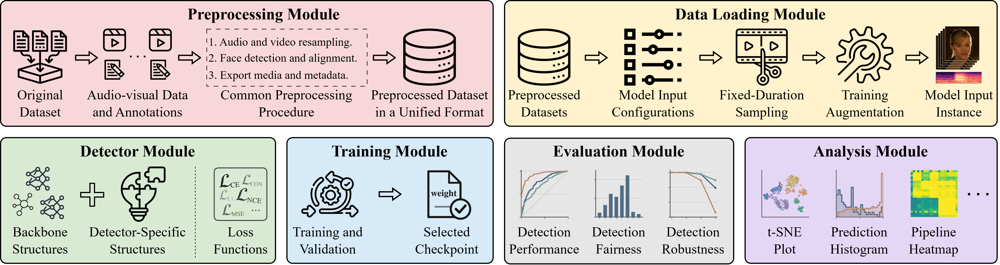

<a id="top"></a>

# Mega-MMDF & DeepfakeBench-MM

[][dataset-hub]
[][model-hub]
[][project-home]
[][paper-arxiv]

[](#top)
[](#installation)
[](#installation)
[](LICENSE)

<!-- TODO: Replace the model repository and homepage placeholders with their public URLs. -->
[dataset-hub]: https://huggingface.co/datasets/iDES/Mega-MMDF
[model-hub]: https://huggingface.co/iDES/DeepfakeBench-MM
[project-home]: https://example.com/mega-mmdf
[paper-arxiv]: https://arxiv.org/abs/2510.22622

Kangran Zhao<sup>&#42;</sup>, Xiaoyu Zhang<sup>&#42;</sup>, Yupeng Chen<sup>&#42;</sup>,
Yize Chen, Weinan Guan, Bo Zheng, Yufan Liao, Chengzhe Sun,
Soumyya Kanti Datta, Qingshan Liu, Siwei Lyu, and Baoyuan Wu<sup>†</sup>

<sup>&#42;</sup> Equal contribution. <sup>†</sup> Corresponding author.

**Mega-MMDF** contains **100,000 real and 1.2 million forged audiovisual clips**,
constructed using **30 forgery methods across 22 forgery pipelines**. See our
[paper][paper-arxiv] for the dataset design and experiments, and visit
[Hugging Face][dataset-hub] to access the dataset.

**DeepfakeBench-MM** is a modular benchmark for multimodal deepfake detection.
Its shared interfaces and configurable components support data preprocessing,
loading, detector implementation, training, evaluation, and analysis, making
the framework highly extensible. We will continue tracking advances in the
field and expanding its datasets, detectors, and evaluation tools.



<a id="contents"></a>
## 🧭 Contents

- [🚀 Quick Start](#quick-start)
- [🧪 More Benchmark Protocols](#benchmark-protocols)
- [🧩 Project Structure](#project-structure)
- [🗃️ Supported Datasets](#supported-datasets)
- [🧠 Supported Detectors](#supported-detectors)
- [📝 Citation](#citation)
- [⚖️ License](#license)
- [🛤️ Next Steps](#next-steps)
- [✉️ Contact](#contact)

<a id="quick-start"></a>
## 🚀 Quick Start

Run the commands from the repository root. The examples below use Bash on Linux
and the Baseline detector, which can train from scratch without external
initialization weights.

<a id="installation"></a>
### 🛠️ 1. Installation

Create the environment following `install.sh`:

```bash
conda create -n DeepfakeBench-MM python=3.10.19 -y
conda activate DeepfakeBench-MM

pip install torch==2.2.0 torchvision==0.17.0 torchaudio==2.2.0 --index-url https://download.pytorch.org/whl/cu118
pip install -r requirements.txt
```

The recipe uses CUDA 11.8 PyTorch wheels. Our reference environment uses
**FFmpeg and FFprobe 4.4.2** on Ubuntu 22.04. Install these executables
separately and make both available on `PATH`.

<a id="data-paths"></a>
### 📂 2. Configure Data Paths

Edit `configs/path.yaml` for your filesystem:

```yaml
original_dir: ./data/original
preprocessed_dir: ./data/preprocessed
json_dir: ./data/json
log_dir: ./logs
```

| Setting | Contents |
|---|---|
| `original_dir` | Downloaded source datasets |
| `preprocessed_dir/audio-video/` | Prepared video, audio, and landmarks |
| `json_dir/audio-video/` | Assembled dataset manifests consumed by the loaders |
| `log_dir` | Root for automatically named training runs and default test outputs |

Keep each dataset in its expected directory under `original_dir`, for example:

```text
original_dir/
├── Mega-MMDF/
├── FakeAVCeleb_v1.2/
├── LAV-DF/
├── PolyGlotFake/
├── IDForge_v1/
├── TalkingHeadBench/
├── DigiFakeAV/
└── ...
```

The [audio-video preprocessing guide](preprocess/audio_video/README.md) describes
the internal layout and split files required by each dataset preprocessor.

<a id="prepare-data"></a>
### 🎬 3. Prepare the Data

Follow the [preprocessing overview](preprocess/README.md) and
[audio-video quick start](preprocess/audio_video/README.md) to prepare the
alignment resources, run a preprocessor, and assemble its dataset manifest. For
example:

```bash
python preprocess/audio_video/mega_mmdf_preprocessor.py --split all --num_proc 8
```

This prepares the media under `preprocessed_dir/audio-video/` and writes
`json_dir/audio-video/Mega-MMDF.json`. The dataset loaders read this assembled
manifest. FakeAVCeleb, PolyGlotFake, and DigiFakeAV use the bundled split files
described in the preprocessing guide.

We are reviewing the redistribution permissions for preprocessed datasets to
reduce duplicated preprocessing effort in the community. We will provide all
preprocessed versions that we are permitted to redistribute.

<a id="training"></a>
### 🏋️ 4. Training

Choose a detector configuration and prepare the training and validation datasets
listed in it. For example, train Baseline on Mega-MMDF with:

```bash
python train.py \
  --detector_path configs/detectors/audio_video/baseline_train_on_megammdf.yaml \
  --log_dir ./logs/train/baseline_megammdf \
  --seed 1024
```

This configuration uses Mega-MMDF for training and the validation splits of
FakeAVCeleb, LAV-DF, PolyGlotFake, IDForge, and Mega-MMDF for model selection.
Prepare those manifests before running the command.
For other detectors, obtain their required backbone or method-pretraining weights
following [pretrained/README.md](pretrained/README.md).

`--log_dir` is the **exact training run directory**. Without `--resume`, the
selected directory is cleared before training starts, including existing logs
and checkpoints. Choose a dedicated run directory. When `--log_dir` is omitted,
the entrypoint creates `log_dir/train/<model_name>_<timestamp>/` under the root
configured in `configs/path.yaml`.

Outputs are organized as:

```text
logs/train/baseline_megammdf/
├── log.txt            # Training configuration, losses, and validation results
├── checkpoints/       # Model-only weights for testing
└── training_states/   # Full states for resuming training
```

To preserve that directory and resume from its latest full training state, add
the **boolean `--resume` flag** and use the same `--log_dir`:

```bash
python train.py \
  --detector_path configs/detectors/audio_video/baseline_train_on_megammdf.yaml \
  --log_dir ./logs/train/baseline_megammdf \
  --resume
```

Resume with the same training configuration. If no resumable full state is
found, the trainer reports this and starts from scratch without clearing the
directory. See the [configuration guide](configs/README.md) to write your own
configuration and connect the data, optimizer, scheduler, and trainer settings.

<a id="testing"></a>
### 🔎 5. Testing

Use a model-only checkpoint from a run's `checkpoints/` directory, or a released
detector checkpoint, with its corresponding detector configuration:

```bash
python test.py \
  --detector_path configs/detectors/audio_video/baseline_train_on_megammdf.yaml \
  --weight_path /path/to/model_only_checkpoint.pth \
  --test_datasets Mega-MMDF FakeAVCeleb LAV-DF \
  --log_dir ./logs/test/baseline_megammdf \
  --metrics 'sample-level AUC' 'video-level AUC'
```

Prepare the test manifests for every dataset passed to `--test_datasets`.
Full `training_states/` containers are for training resume, rather than ordinary
testing. Checkpoint download and placement instructions are in
[weights/README.md](weights/README.md).

Test `--log_dir` is the exact output directory. Predictions are saved under its
`predictions/` subdirectory. Omit `--metrics` to save predictions only; adding
metrics in a later run with the same checkpoint and settings reuses those
predictions. Use a new output directory when changing the checkpoint or
evaluation setting, because existing outputs are reused by file existence.

<a id="benchmark-protocols"></a>
## 🧪 More Benchmark Protocols

The [commands guide](commands/README.md) collects training and testing examples,
including fairness, post-processing robustness, modality masking, audiovisual
misalignment, cross-pipeline evaluation, and data-scale experiments.

Each protocol explains its required data and outputs. Fairness evaluation needs
demographic annotations in the dataset JSON before inference; post-processing
robustness needs the perturbed files to be generated before testing. Follow the
corresponding command guide to prepare these inputs.

<a id="project-structure"></a>
## 🧩 Project Structure

| Module | Purpose |
|---|---|
| [configs](configs/README.md) | Paths, detector settings, and experiment protocols |
| [commands](commands/README.md) | Runnable examples and benchmark protocol instructions |
| [preprocess](preprocess/README.md) | Raw-dataset adaptation, alignment, and metadata assembly |
| [datasets](datasets/README.md) | Dataset construction, sampling, input representations, and data utilities |
| [backbones](backbones/README.md) | Reusable feature encoders |
| [detectors](detectors/README.md) | Detector interfaces, predictions, and loss composition |
| [losses](losses/README.md) | Standard and method-specific objectives |
| [optimizers](optimizers/README.md) | Optimizer construction |
| [schedulers](schedulers/README.md) | Learning-rate scheduling |
| [trainers](trainers/README.md) | Optimization, validation, and training resume |
| [metrics](metrics/README.md) | Detection and fairness evaluation |
| [analysis](analysis/README.md) | Prediction analysis and figure generation |
| [tools](tools/README.md) | Registries, logging, seeds, and shared utilities |

<a id="supported-datasets"></a>
## 🗃️ Supported Datasets

The following dataset names are used in configurations and command-line options:

| Dataset | Paper | Publication |
|---|---|---|
| Mega-MMDF | [DeepfakeBench-MM: A Comprehensive Benchmark for Multimodal Deepfake Detection](https://arxiv.org/abs/2510.22622) | arXiv 2025 |
| FakeAVCeleb | [FakeAVCeleb: A Novel Audio-Video Multimodal Deepfake Dataset](https://datasets-benchmarks-proceedings.neurips.cc/paper_files/paper/2021/hash/d9d4f495e875a2e075a1a4a6e1b9770f-Abstract-round2.html) | NeurIPS Datasets and Benchmarks 2021 |
| LAV-DF | [Glitch in the Matrix: A Large Scale Benchmark for Content Driven Audio-Visual Forgery Detection and Localization](https://www.sciencedirect.com/science/article/pii/S1077314223001984) | CVIU 2023 |
| PolyGlotFake | [PolyGlotFake: A Novel Multilingual and Multimodal DeepFake Dataset](https://link.springer.com/chapter/10.1007/978-3-031-78341-8_12) | ICPR 2024 |
| IDForge | [Identity-Driven Multimedia Forgery Detection via Reference Assistance](https://dl.acm.org/doi/10.1145/3664647.3680622) | ACM MM 2024 |
| TalkingHeadBench | [TalkingHeadBench: A Multi-Modal Benchmark & Analysis of Talking-Head DeepFake Detection](https://ieeexplore.ieee.org/document/11492029/) | WACV 2026 |
| DigiFakeAV | [Beyond Face Swapping: A Diffusion-Based Digital Human Benchmark for Multimodal Deepfake Detection](https://ieeexplore.ieee.org/document/11462517/) | ICASSP 2026 |
| MMDF | [X-AVDT: Audio-Visual Cross-Attention for Robust Deepfake Detection](https://openaccess.thecvf.com/content/CVPR2026/html/Kim_X-AVDT_Audio-Visual_Cross-Attention_for_Robust_Deepfake_Detection_CVPR_2026_paper.html) | CVPR 2026 |

Source datasets are obtained separately from their providers. Directory layouts,
split files, and preprocessor usage are documented in the
[preprocessing guide](preprocess/audio_video/README.md).

To integrate your own dataset, follow the
[preprocessing interface](preprocess/README.md) to produce the shared data format.
For custom sampling or input behavior, see the
[dataset extension guide](datasets/README.md).

<a id="supported-detectors"></a>
## 🧠 Supported Detectors

| Detector | Paper | Publication |
|---|---|---|
| Baseline | — | — |
| AVFF | [AVFF: Audio-Visual Feature Fusion for Video Deepfake Detection](https://openaccess.thecvf.com/content/CVPR2024/html/Oorloff_AVFF_Audio-Visual_Feature_Fusion_for_Video_Deepfake_Detection_CVPR_2024_paper.html) | CVPR 2024 |
| AVH | [Circumventing Shortcuts in Audio-visual Deepfake Detection Datasets with Unsupervised Learning](https://openaccess.thecvf.com/content/CVPR2025/html/Smeu_Circumventing_Shortcuts_in_Audio-visual_Deepfake_Detection_Datasets_with_Unsupervised_Learning_CVPR_2025_paper.html) | CVPR 2025 |
| FauForensics | [FauForensics: Boosting Audio-Visual Deepfake Detection With Facial Action Units](https://doi.org/10.1109/TIFS.2026.3674401) | IEEE TIFS 2026 |
| FGMDF | [Fine-Grained Multimodal DeepFake Classification via Heterogeneous Graphs](https://link.springer.com/article/10.1007/s11263-024-02128-1) | IJCV 2024 |
| FRADE | [FRADE: Forgery-aware Audio-distilled Multimodal Learning for Deepfake Detection](https://doi.org/10.1145/3664647.3681672) | ACM MM 2024 |
| MCL | [MCL: Multimodal Contrastive Learning for Deepfake Detection](https://doi.org/10.1109/TCSVT.2023.3312738) | IEEE TCSVT 2024 |
| SpeechForensics | [SpeechForensics: Audio-Visual Speech Representation Learning for Face Forgery Detection](https://proceedings.neurips.cc/paper_files/paper/2024/hash/9c7900fac04a701cbed83256b76dbaa3-Abstract-Conference.html) | NeurIPS 2024 |

To implement your own detector, follow the shared interface and registration
steps in [detectors/README.md](detectors/README.md). Model inputs, pretraining,
and weight requirements are documented in the
[method guide](detectors/audio_video/README.md); configuration fields are described
in [configs/detectors/audio_video/](configs/detectors/audio_video/README.md).

<a id="citation"></a>
## 📝 Citation

TODO

<!-- <a id="license"></a>
## ⚖️ License

The original code in this repository is licensed by
[The Chinese University of Hong Kong, Shenzhen (CUHK(SZ))](https://www.cuhk.edu.cn/en)
under [CC BY-NC 4.0](https://creativecommons.org/licenses/by-nc/4.0/).
See [LICENSE](LICENSE) for the full terms.

This project is developed by **iDES** at CUHK(SZ), led by Professor Baoyuan Wu.

Dataset and model-weight
licenses are specified in their respective repositories. -->

<!--
<a id="acknowledgements"></a>
## 🙏 Acknowledgements

TODO
-->

<!--
<a id="more-from-our-group"></a>
## 🔬 More from Our Group

TODO
-->

<a id="next-steps"></a>
## 🛤️ Next Steps

We plan to:

- Release redistributable preprocessed data and trained detector checkpoints.
- Integrate emerging datasets and detector implementations.
- Extend the shared workflows to image, video-only, and audio-only inputs.

<a id="contact"></a>
## ✉️ Contact

<a id="license"></a>

This repository is licensed by [The Chinese University of Hong Kong, Shenzhen](https://www.cuhk.edu.cn/en) under Creative Commons Attribution-NonCommercial 4.0 International Public License (identified as [CC BY-NC-4.0 in SPDX](https://spdx.org/licenses/)). More details about the license could be found in [LICENSE](./LICENSE).

This project is built by the Intelligent Digital Economy Securit (iDES) Lab at The School of Data Science (SDS) of The Chinese University of Hong Kong, Shenzhen, directed by Professor [Baoyuan Wu](https://sites.google.com/site/baoyuanwu2015/home). The iDES Lab focuses on the research of trustworthy AI, including adversarial machine learning , agent security and safety, deepfake and AIGC detection, data governance, etc

If you have any suggestions, comments, or wish to contribute code or propose methods, we warmly welcome your input. Please contact us at [Baoyuan Wu](mailto:wubaoyuan@cuhk.edu.cn) or [Kangran Zhao](mailto:kangranzhao@link.cuhk.edu.cn). We look forward to collaborating with you in pushing the boundaries of deepfake detection.

[⬆️ Back to top](#top)
